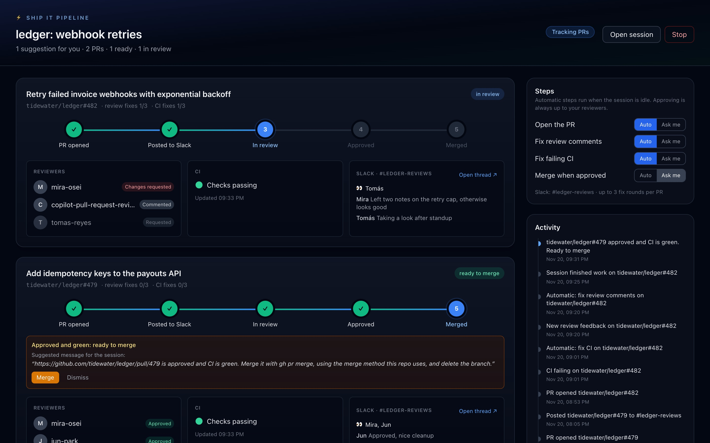

# Polyergon

**Run every Claude Code session from one screen.**

Polyergon is a local app for people who run many Claude Code (or GitHub Copilot CLI) sessions at once. It shows which sessions need you, ships their pull requests, keeps up with Slack, and records meetings. It runs on your machine, and it's open source under the MIT license.

[polyergon.ai](https://polyergon.ai)



> **Status:** early (v0.1). Built and tested on macOS. Sessions should work on Linux but are untested. Windows is not supported.

## What it does

### Sessions
- Real Claude Code and Copilot terminals in the browser, side by side.
- Each card shows whether the session is **thinking**, **waiting for you** or **idle**, what it cost, and how close it is to auto-compacting.
- Start a plain chat, open a project folder, resume by session ID, or **start from a Slack channel, thread or DM** so the session begins with that context.
- Pick the model per session. Desktop and sound alerts when a session needs input. Search everything with <kbd>⌘K</kbd>.

### Ship it: PRs that move on their own
Turn it on for a session and it runs the loop you usually babysit:

1. **Open the PR** when the session has code to ship.
2. **Post it for review** in a Slack channel, and track who picked it up.
3. **Fix review comments**: new feedback goes back to the session, which fixes, pushes and replies on the PR.
4. **Fix failing CI** the same way.
5. **Merge** when it's approved and green.

Each step can be **Auto** or **Ask me**. By default steps 1 to 4 are automatic and merging asks you. Fix rounds are capped per PR (3 by default), then it asks you. Approving is always left to your reviewers.

### Slack
- **Inbox:** mentions and DMs still waiting on you, as cards with a suggested reply. Reply, react, mark done, or link the card to a session so drafts use what that session knows.
- **Channel watcher:** finds unanswered questions in a channel and drafts replies, optionally with a session's knowledge, extra sources (links, folders, channels, notes) and your own rules. You approve each reply, or let it answer new questions on its own. Every action is in an activity log.

### Meetings (beta, macOS)
Record a call and get a live transcript, running notes, answers to your questions and a summary. Add context from links, Slack channels, past meetings or sessions. Search every recording, continue a stopped one, and send the summary to Slack.

### More
- **Orgs:** keep separate Claude accounts apart. Each org has its own login, Slack workspace, skills, plugins and automations.
- **Skills:** browse, write and install skills and plugins from the marketplace, per org.
- **PRs and usage:** your open PRs, review requests and merges from GitHub (needs `gh`), and token cost per session and per org.
- **Notes** with reminders, and a **Home** dashboard of everything that needs you.

## Requirements

- macOS, Node.js 20 or newer
- [Claude Code](https://docs.claude.com/en/docs/claude-code) installed and logged in, and/or GitHub Copilot CLI
- Optional: [`gh`](https://cli.github.com) for PRs and Ship it
- Optional, Slack features: the Slack connector or plugin in Claude Code
- Optional, meetings: `ffmpeg`, [BlackHole](https://github.com/ExistentialAudio/BlackHole), and an OpenAI or Azure OpenAI key for transcription

## Install

```bash
git clone https://github.com/polyergon/polyergon.git
cd polyergon
npm ci
npm run build
npm start          # opens Polyergon in its own window
```

Polyergon opens in its own window, with no tabs or address bar, at `http://polyergon.localhost:3030`. To keep it in the Dock, choose **Install Polyergon** from Chrome's menu.

Most options are set in the app under **Settings**: Claude sign-in or API key, auto-compact, permission prompts, keeping the Mac awake, notifications and the transcription key.

### Environment variables

| Variable | Default | Purpose |
|---|---|---|
| `PORT` | `3030` | Port to listen on |
| `POLYERGON_DATA_DIR` | `~/.claude-session-manager` | Where sessions, notes, meetings, automations and settings are stored |
| `POLYERGON_NO_OPEN` | unset | Set to `1` to not open a window on start |
| `POLYERGON_WINDOW` | unset | Set to `browser` to open a normal browser tab instead of the app window |
| `POLYERGON_ALLOWED_HOSTS` | unset | Extra host names allowed to reach the app (comma-separated) |

## Security

Polyergon drives real shells, so it is built to be reachable only by you.

- It listens on `127.0.0.1` only, and rejects requests from other websites (Host and Origin checks).
- API keys are stored on your machine in a file only your user can read, and never sent to the browser.
- Sessions ask before running commands or editing files, as Claude Code and Copilot normally do. **Settings → Skip permission prompts** turns that off. Only use it with folders you trust.
- **Automations type into your sessions** when a step is set to Auto (Ship it), and a channel watcher set to answer automatically **posts to Slack as you**. Set steps to Ask me if you want to approve each one.
- Background helpers (meeting assistant, Slack drafts, watchers) run headless with permission prompts off, so they can read links and connector content you give them. Content you add (links, meeting audio, Slack messages) becomes their input, so only add sources you trust.

Report vulnerabilities to **security@polyergon.ai**. See [SECURITY.md](SECURITY.md).

## Development

```bash
npm run dev        # hot reload on http://localhost:3030
npm test           # unit tests
```

The app is a Next.js front end with a small Node server (`server.ts`) that owns the terminals (node-pty), automations and Slack helpers. Code lives in `src/app` (UI) and `src/lib` (server logic). Issues and pull requests are welcome.

## License

[MIT](LICENSE) © Ofir Yehoshua
